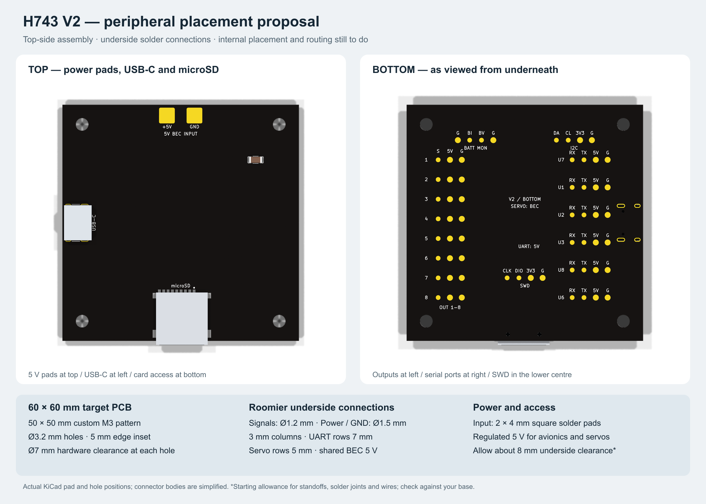
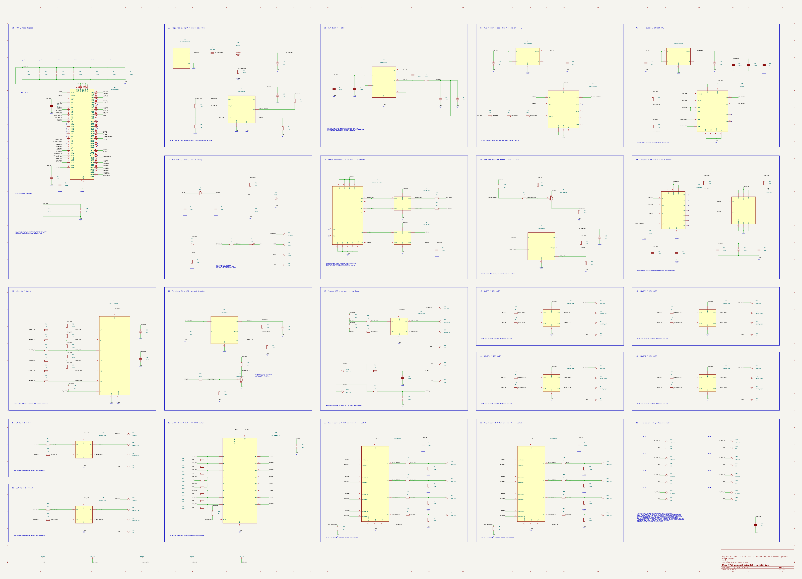

Compact STM32H743 autopilot in KiCad: shared regulated 5 V BEC input pads, USB-C, microSD and underside solder pads.
V2 targets 60 × 60 mm with custom 50 × 50 mm M3 mounting; ERC passes, peripherals are placed, internals remain unplaced/unrouted, and DRC has not passed.

